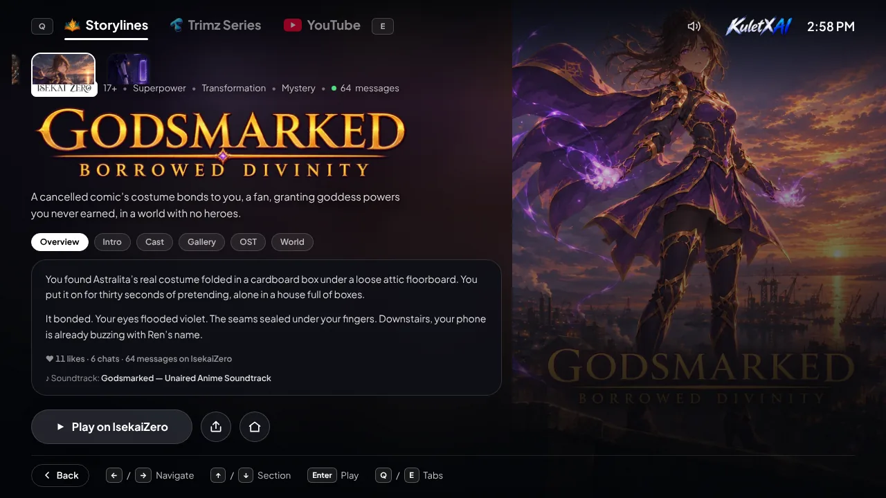

# KuletX AI

The home of KuletX's interactive AI stories: a landing page, a console-style hub for every story, and links out to the series and videos made from them.

Live at [kuletxai.whop.site](https://kuletxai.whop.site), mirrored at [kuletxai.kuletxcore.workers.dev](https://kuletxai.kuletxcore.workers.dev).



## What's in it

- **Story hub.** Every story gets its own screen with an overview, intro card, cast, gallery, soundtrack player and trophies. It works with a controller, a keyboard or touch.
- **Two platforms.** Stories live on [IsekaiZero](https://www.isekaizero.ai), and the 18+ ones on [KageSekai](https://www.kagesekai.ai). Likes, chats and message counts are read from each platform's API.
- **Series and videos.** The Trimz series and YouTube videos sit in the same hub, next to the stories they came from.
- **Lite mode.** Weak phones and old integrated GPUs get a lighter site with no video backdrops or blur. It switches on by itself and can be toggled in the volume panel.
- **Startup screen.** A short boot sequence plays once per session.

## Stack

[TanStack Start](https://tanstack.com/start) (React 19) on Vite, styled with Tailwind CSS 4. It runs on Cloudflare Workers and on Whop.

## Run it locally

Built and tested on Node 22.

```bash
npm install
npm run dev
```

The dev server is at http://localhost:3000. `npm run typecheck`, `npm run build` and `npm run preview` do what they say.

## Where things are

```
src/routes      pages (home, story hub, trophy list) and the two API routes
src/components  site chrome, boot screen, platform badges
src/data        story copy, cast and gallery, soundtracks, music, trophies
src/lib         sound, gamepad, lite-mode detection, live counts
scripts         build_isk.py and build_ost.py, which refresh data from the platforms
public          covers, tiles, hosted story art and cards, music, fonts
```

Story copy, tags and links are written by hand in `src/data/content.ts`. `src/data/isk.ts` and `src/data/ost.ts` are generated, so refresh them with the scripts instead of editing them.

## Refreshing story data

```bash
pip install pillow
python3 scripts/build_isk.py wristbound
python3 scripts/build_ost.py wristbound
```

`build_isk.py` downloads covers, gallery images, cast portraits and intro cards from the public APIs into `public/isk` and rewrites `src/data/isk.ts`. `build_ost.py` rewrites `src/data/ost.ts`. Soundtrack audio is not hosted here: it streams from the platforms through `/api/ost`. Leave the story name off to refresh every story.

## Branches and deploys

- `main` is production. Cloudflare builds it with `npm run build` and `npx wrangler deploy`.
- `test` is the preview, at [test-kuletxai.kuletxcore.workers.dev](https://test-kuletxai.kuletxcore.workers.dev). New work lands here first.
- Whop is deployed by hand with `npm run deploy`, which runs `whop apps deploy` and needs the Whop CLI signed in. The build zip has to stay under 50 MB. The command also rewrites the Worker `name` in `wrangler.jsonc`, so put it back before committing.

## License

MIT. See [LICENSE](LICENSE).
